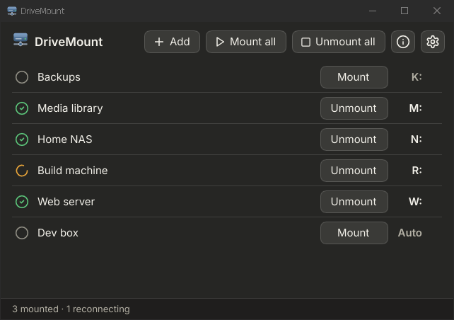

# DriveMount

DriveMount (working title; executable `drivemount.exe`) is a Windows desktop application that mounts remote disks as drive letters. It keeps a list of connections, mounts or unmounts each with one click, restores mounts at start-up and after network drops, and lives in the system tray.

It is a native Rust program built on [WinFsp](https://winfsp.dev). It needs no external SSHFS tooling and runs as a normal, unelevated user process.



| Release | Content |
|---|---|
| **v1** (milestones M0–M2) | SSH/SFTP connections as drive letters, tray, auto-mount, auto-reconnect, Windows Credential Manager, host-key verification, settings, MSI installer |
| **M3** | SMB 2/3 connections, through Windows' own SMB client |
| **M4** | NFSv3 connections, with a built-in userspace client |

It targets Windows 10 22H2 and Windows 11 23H2 or later, on x64.

## Status

**Early development: there is no usable application yet.** Milestone M1 is in progress. The SFTP backend and the WinFsp drive adapter are done, but profiles, the mount manager and the UI are still to come, and `drivemount.exe` currently does nothing. Task-by-task notes are in [docs/PROGRESS.md](docs/PROGRESS.md).

## User guide

In short:

1. **Install** DriveMount with its MSI. It needs [WinFsp](https://winfsp.dev/rel/) 2.1 or later, which the installer offers if it is missing.
2. **Add a connection:** choose **Add** (Ctrl+N) and fill in a name, the host, your user name, how you log in (*Key file*, *Password*, *SSH agent* or *Ask each time*), the remote path (`~` for your home folder) and a drive letter, or *Auto*. You can paste `user@host:port/path` into **Host**. **Test connection** checks it without mounting; then **Save**.
3. **Mount:** choose **Mount** on the row, or press Enter. The first time, check the server's key fingerprint and choose **Trust and save**. The drive appears in Explorer under *Network locations*.
4. **Unmount** from the same button, or use **Mount all** and **Unmount all** on the toolbar. The tray icon's right-click menu has the same actions.

Closing the window keeps DriveMount in the tray with the drives mounted. After sleep or a network drop, drives reconnect by themselves. Passwords you choose to remember go to Windows Credential Manager, never to a file.

The full guide, [docs/USER_GUIDE.md](docs/USER_GUIDE.md), covers each field and login method, server keys, the tray, settings, keyboard shortcuts, what to do about every error message, and where DriveMount keeps its data.

## Development

### Prerequisites

- **Rust**, through [rustup](https://rustup.rs). [rust-toolchain.toml](rust-toolchain.toml) pins the version, and rustup installs it on first use.
- **Visual Studio Build Tools**, with the "Desktop development with C++" workload (MSVC linker and Windows SDK).
- **LLVM**, for the `libclang` that `winfsp-sys` needs at build time.
- **WinFsp with its Developer feature** (headers and import libraries). From an administrator PowerShell, this installs the pinned version unless WinFsp is already there:

  ```powershell
  scripts\install-winfsp.ps1
  ```

- **OpenSSH client**: the `known_hosts` tests call `ssh-keygen`.
- **Docker Engine inside WSL2** (Ubuntu-22.04), only for the tests that need real servers. Docker Desktop is not used.

For the lint checks that CI runs, also install the same versions of these tools:

```powershell
cargo install --locked --version 0.20.2 cargo-deny
cargo install --locked --version 0.22.2 cargo-audit
```

### Layout

| Path | Contents |
|---|---|
| `apps/drivemount` | The GUI binary, `drivemount.exe`, and the library behind it that makes real drives and the main window. `cargo run -p drivemount --example main_window` shows the window with made-up connections, and `--example connect` runs `drivemount.exe` on a scratch configuration. `--example mount_one` mounts, checks and unmounts one profile with no window, for scripts |
| `crates/drivemount-vfs` | Shared traits and types (`RemoteFs`, `Connector`, `MountBackend`), caches, read-ahead, deadlines |
| `crates/drivemount-core` | Profiles, configuration and the mount manager |
| `crates/drivemount-sftp` | `RemoteFs` over SFTP, and its connector |
| `crates/drivemount-smb` | Native Windows SMB mappings (M3) |
| `crates/drivemount-nfs` | `RemoteFs` over NFSv3 (M4) |
| `crates/drivemount-win` | Windows helpers: credentials, drive letters, shell, WinFsp detection |
| `crates/drivemount-winfsp` | Adapter from `RemoteFs` to a WinFsp drive |
| `scripts` | CI checks, installers and packaging |
| `apps/drivemount/wix`, `apps/drivemount/setup`, `packaging` | The MSI, the setup exe, and the template of the third-party licence file |
| `tests` | Test servers (Docker) and the `winfsp-tests` exclusions |
| `spikes` | Throw-away experiments from M0, in their own workspaces |

### Build

```powershell
cargo build --workspace --locked
cargo build --release -p drivemount --locked
```

The workspace also builds on Linux, where the Windows-only crates (`drivemount-win`, `drivemount-winfsp`, `drivemount-smb`) are empty.

### Packaging

`scripts\package.ps1` builds the setup exe, the MSI and the portable zip into `target\package` (spec §9). It needs:

- `cargo install --locked --version 0.3.9 cargo-wix` and `cargo install --locked --version 0.9.3 cargo-about`;
- the [WiX Toolset 3.14](https://github.com/wixtoolset/wix3/releases) binaries, unzipped; give the folder with `-Wix` or the `WIX` variable;
- the unmodified WinFsp MSI from [winfsp.dev](https://winfsp.dev/rel/) (`-WinFspMsi`), which the setup exe installs when WinFsp is missing.

`-TargetDir target\dist` builds in a folder of its own, which leaves a running `target\release\drivemount.exe` alone. `scripts\test-installer.ps1` installs, upgrades and uninstalls two such builds on this PC from an elevated PowerShell; its help says how.

### Checks

CI runs all of these, so run them before committing. The two `.sh` scripts need a POSIX shell, such as Git Bash.

```powershell
cargo fmt --all --check
cargo clippy --workspace --all-targets --locked -- -D warnings
cargo deny --locked check
cargo audit
sh scripts/check-spdx.sh
sh scripts/check-secret-format.sh
scripts\check-exe-size.ps1    # after a release build; drivemount.exe must stay under 30 MB
```

### Conventions

- Every `.rs` and `.slint` file starts with `// SPDX-License-Identifier: GPL-3.0-or-later`.
- Dependencies are pinned to exact versions in the root [Cargo.toml](Cargo.toml). Changing one is a deliberate edit.
- `unwrap` and `expect` are denied outside tests. `unsafe` is allowed only in `drivemount-win` and `drivemount-winfsp`, and each block needs a `// SAFETY:` comment.

## Tests

### Unit and drive tests

```powershell
cargo test --workspace --locked
```

On Windows this mounts real, short-lived drives through WinFsp, so the WinFsp driver must be usable. No servers are needed.

Tests marked `#[ignore]` need something extra, and each says what. Run them per crate or test file as shown below, rather than with `--workspace --ignored`.

### Drive tests over SFTP

This runs the same drive tests through a real SFTP session, against a server inside the test process:

```powershell
$env:DRIVEMOUNT_TEST_SERVER = 'sftp'
cargo test -p drivemount-winfsp --locked --test read_path --test write_path --test fsx
Remove-Item Env:DRIVEMOUNT_TEST_SERVER
```

`FSX_OPS` and `FSX_SEED` set the length and seed of a `tests/fsx.rs` run, which is how to repeat a failure or run longer.

### Tests against real servers

These need the OpenSSH and ProFTPD containers, which run on Docker Engine in WSL2. The users, keys and ports are listed in [tests/docker/README.md](tests/docker/README.md).

```powershell
tests\docker\servers.ps1 up       # generate keys if missing, build, start
tests\docker\servers.ps1 check    # verify every auth method
cargo test -p drivemount-sftp --locked -- --ignored
tests\docker\servers.ps1 down
```

The tests look for the servers on `localhost`. `tests/sftpfs.rs` alone can use another host, through `DRIVEMOUNT_TEST_HOST`.

The mount manager with the real factory, through real drives, needs those servers and WinFsp together. Secrets go to a store in memory, and Explorer is told about the drives:

```powershell
cargo test -p drivemount --test real_drive -- --ignored --test-threads=1
```

For throughput measurements, connect to the WSL VM's IP (`wsl hostname -I`) rather than `localhost`, because the Windows port-forward relay distorts the results:

```powershell
cargo run --release -p drivemount-sftp --example sftpfs_throughput -- <host> [MiB] [runs]
```

### WinFsp's own test suite

`winfsp-tests` is not part of the WinFsp installer, so this script fetches a pinned copy into `target\winfsp-tests`:

```powershell
powershell -File scripts/get-winfsp-tests.ps1
cargo test -p drivemount-winfsp --locked --test winfsp_tests -- --ignored --test-threads=1 --nocapture
```

Set `WINFSP_TESTS` to use a copy from elsewhere. The tests left out, with the reason for each, are in [tests/winfsp-tests-exclusions.txt](tests/winfsp-tests-exclusions.txt).

### Tests that need a desktop

CI cannot run these. They need a signed-in desktop, and they open an Explorer window on "This PC" for a moment:

```powershell
cargo test -p drivemount-winfsp --test explorer -- --ignored --test-threads=1
```

`cargo test -p drivemount-win -- --ignored` runs the `drivemount-win` tests that need a desktop or an installed WinFsp. Some of them change this user's settings for a moment, and each says what it touches.

### Continuous integration

[.github/workflows/ci.yml](.github/workflows/ci.yml) defines all of the above except the desktop tests, for GitHub Actions or Gitea Actions. The header of that file lists what a runner needs. The workflow has not run on a runner yet.

## Documentation

| Document | Contents |
|---|---|
| [docs/USER_GUIDE.md](docs/USER_GUIDE.md) | How to install and use DriveMount |
| [docs/SPECIFICATION.md](docs/SPECIFICATION.md) | Requirements and design |
| [docs/ANALYSIS.md](docs/ANALYSIS.md) | Reference program, problems, technology rationale |
| [docs/IMPLEMENTATION_PLAN.md](docs/IMPLEMENTATION_PLAN.md) | Milestones and tasks |
| [docs/PROGRESS.md](docs/PROGRESS.md) | Notes per task: decisions and open issues |
| [docs/TRACEABILITY.md](docs/TRACEABILITY.md) | Requirements traced to tasks and tests |
| [docs/adr](docs/adr) | Architecture decision records |
| [docs/spikes](docs/spikes) | Results of the M0 spikes |

## Licence

GPL-3.0-or-later: see [LICENSE](LICENSE) and [ADR-0003](docs/adr/0003-licence-gplv3.md).
